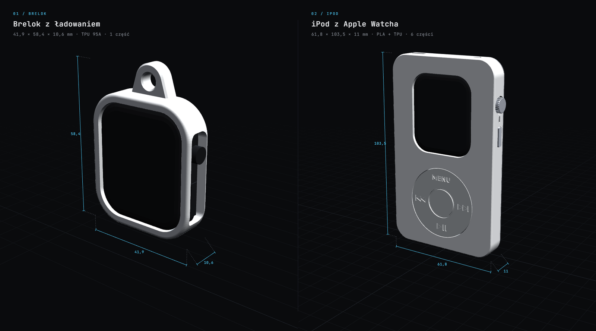
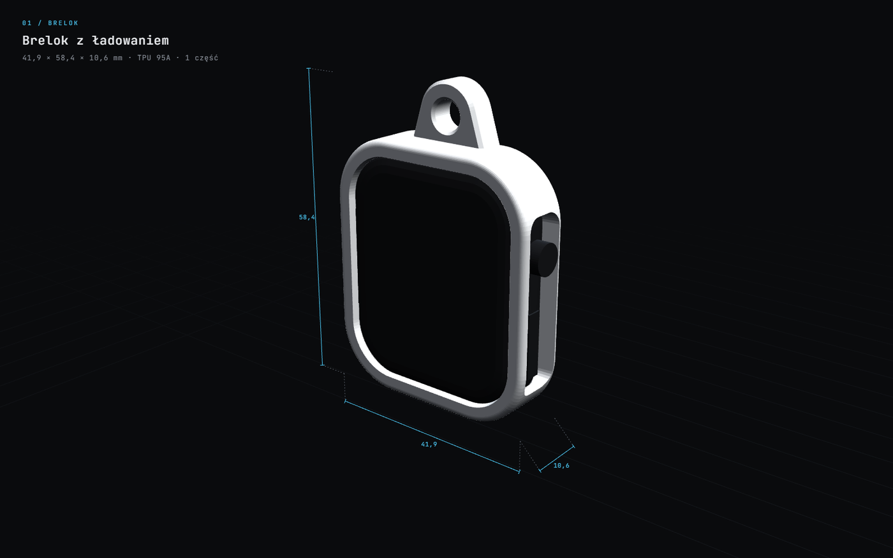
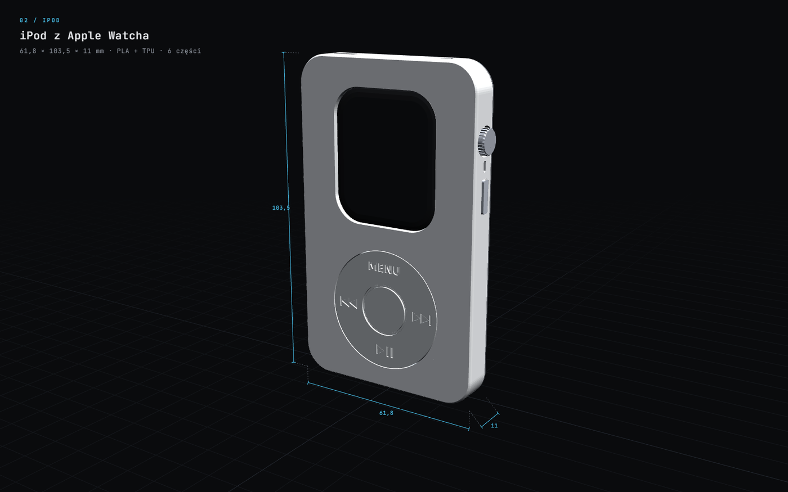
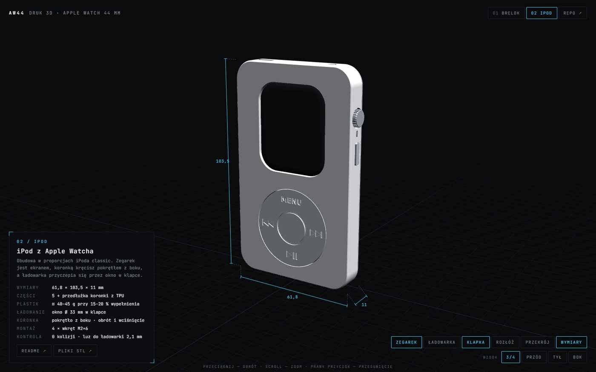

<div align="center">

<a href="https://pi0trdotsys.github.io/apple-watch-3d-prints/"></a>

# AW44

**druk 3D dla Apple Watch 44 mm** &nbsp;·&nbsp; Series 4 · 5 · 6 · SE

[**▶ interaktywny podgląd 3D**](https://pi0trdotsys.github.io/apple-watch-3d-prints/) &nbsp;·&nbsp; [`01` brelok](brelok/) &nbsp;·&nbsp; [`02` ipod](ipod/)

<sub>STL &nbsp;·&nbsp; parametryczne &nbsp;·&nbsp; Python + manifold3d &nbsp;·&nbsp; FDM</sub>

</div>

<br>

Dwa parametryczne modele, które dają staremu Apple Watchowi nowe zadanie.
W obu tył zostaje odsłonięty, więc krążek ładowarki przyczepia się **bez wyjmowania zegarka**.

<table>
<tr>
<td width="50%" valign="top">

<a href="brelok/"></a>

**`01` / brelok** &nbsp; ramka z oczkiem na klucze

| | |
|---|---|
| wymiary | 41,9 × 58,4 × 10,6 mm |
| materiał | TPU 95A |
| części | 1 |
| masa | ≈ 4 g |

</td>
<td width="50%" valign="top">

<a href="ipod/"></a>

**`02` / ipod** &nbsp; obudowa w proporcjach iPoda classic

| | |
|---|---|
| wymiary | 61,8 × 103,5 × 11 mm |
| materiał | PLA / PETG + TPU |
| części | 5 + przedłużka koronki |
| masa | ≈ 40–45 g |

</td>
</tr>
</table>

## podgląd 3D

[](https://pi0trdotsys.github.io/apple-watch-3d-prints/)

| gdzie | jak |
|---|---|
| w przeglądarce | [pi0trdotsys.github.io/apple-watch-3d-prints](https://pi0trdotsys.github.io/apple-watch-3d-prints/): obrót, zegarek, ładowarka, wymiary, przekrój, rozkładanie na części |
| lokalnie | otwórz `docs/index.html` (wystarczy dwuklik; three.js ładuje się z internetu) |
| na GitHubie | kliknij dowolny plik `.stl`, a GitHub pokaże go w 3D |

Stan widoku zapisuje się w adresie, np. [`#model=ipod&rozloz=1&ladowarka=1`](https://pi0trdotsys.github.io/apple-watch-3d-prints/#model=ipod&rozloz=1&ladowarka=1).

## start

```bash
pip install -r requirements.txt
python brelok/generuj_brelok.py
python ipod/generuj_ipod.py
```

Każdy generator zapisuje:
- `stl/`: części ułożone do druku,
- `raport.json`: wymiary, masę i kontrolę kolizji,
- `docs/dane_*.js`: dane podglądu 3D.

## struktura

```
apple-watch-3d-prints/
├── brelok/              01 · ramka-brelok
│   ├── stl/             wersje TPU i PETG
│   ├── img/             wizualizacje i przekroje
│   └── generuj_brelok.py
├── ipod/                02 · obudowa iPod
│   ├── stl/             5 części, 5 rozmiarów przedłużki, element testowy
│   ├── img/
│   └── generuj_ipod.py
├── docs/                interaktywny podgląd 3D (GitHub Pages)
├── img/                 grafiki README
└── requirements.txt
```

## dokładność

Apple podaje tylko obrys koperty: **44 × 38 × 10,7 mm**. Profil boku, promień narożników, wypukłość czujnika i położenie koronki to szacunki. Są zapisane na górze generatorów i można je poprawić.

Każdy model sprawdza kolizje z modelem zegarka i ładowarki (wyniki w `raport.json`). Prawdziwy zegarek może się jednak różnić o dziesiąte części milimetra, dlatego zacznij od wydruku testowego. Szczegóły są w README modelu.

## uwagi

Apple Watch i iPod są znakami towarowymi Apple Inc. To niezależny projekt, bez logo i oznaczeń Apple.
