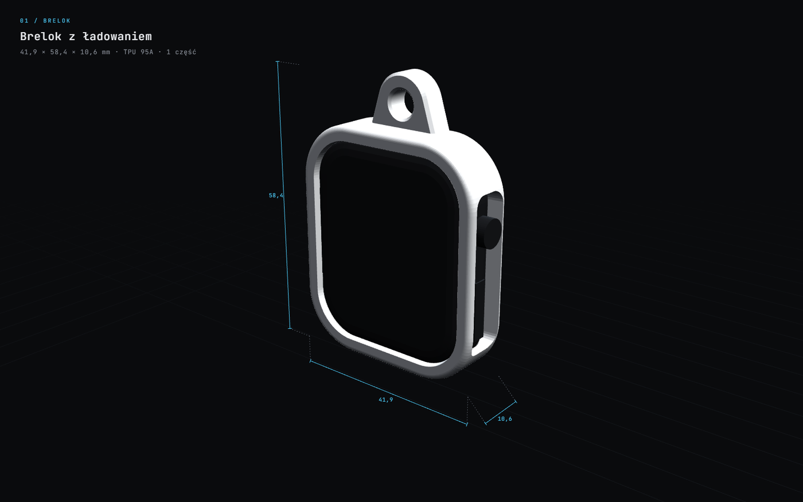
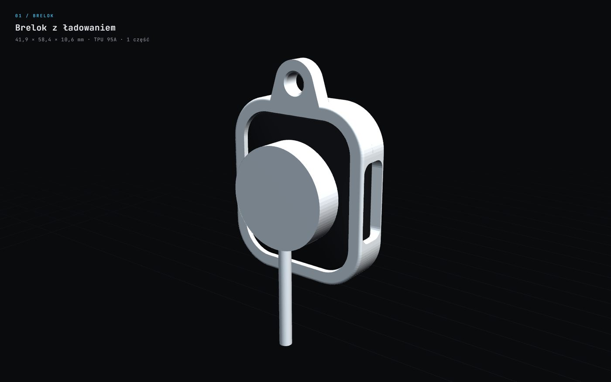
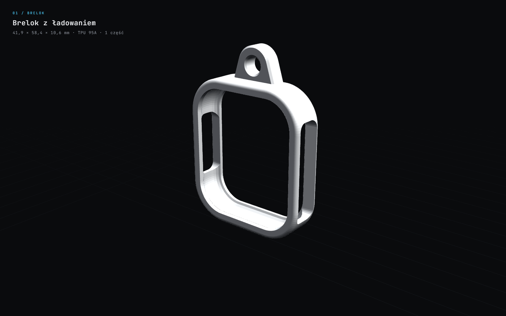
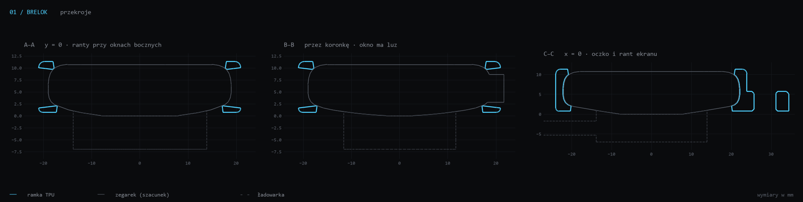

<div align="center">

<a href="https://pi0trdotsys.github.io/apple-watch-3d-prints/#model=brelok"></a>

`01 / brelok`

# Brelok z ładowaniem

Ramka na Apple Watch 44 mm z oczkiem na klucze.<br>
Tył zostaje otwarty, więc zegarek ładujesz bez wyjmowania.

[**▶ podgląd 3D**](https://pi0trdotsys.github.io/apple-watch-3d-prints/#model=brelok) &nbsp;·&nbsp; [stl](stl/) &nbsp;·&nbsp; [generator](generuj_brelok.py) &nbsp;·&nbsp; [← AW44](../)

</div>

<br>

| | TPU · zalecany | PETG · do testu |
|---|---|---|
| plik | [`brelok_AW44_TPU.stl`](stl/brelok_AW44_TPU.stl) | [`brelok_AW44_PETG.stl`](stl/brelok_AW44_PETG.stl) |
| wymiary | 41,9 × 58,4 × 10,6 mm | 41,5 × 58,0 × 10,6 mm |
| masa | ≈ 4,2 g | ≈ 3,7 g |
| ścianka | 1,8 mm | 1,5 mm |
| luz | 0,15 mm | 0,25 mm |
| rant przód / tył | 1,6 / 2,2 mm | 1,6 / 1,0 mm |

## jak działa

- **rant z przodu** zachodzi 1,6 mm na szkło i wystaje 0,6 mm ponad nie, więc klucze nie rysują ekranu,
- **rant z tyłu** chwyta zaokrąglenie koperty, a środek pleców zostaje odsłonięty,
- **prawe okno**: koronka, mikrofon i przycisk boczny; **lewe okno**: głośnik, żeby było słychać „Ping” z iPhone'a,
- **oczko** ma otwór Ø 5,5 mm na kółko od kluczy i drukuje się bez podpór.

| tył: ładowanie bez wyjmowania | sama ramka |
|---|---|
|  |  |



## druk

| | |
|---|---|
| pozycja | tyłem do stołu, tak jak w pliku; bez podpór |
| warstwa | 0,2 mm, 4 obrysy (ścianki wychodzą pełne) |
| TPU 95A | 20–25 mm/s, chłodzenie włączone |
| most | ok. 31 mm nad prawym oknem; jeśli filament słabo mostkuje, włącz podpory tylko w oknach |

**Zakładanie:** koronka idzie po prawej stronie (duże okno). Wsuń górną krawędź zegarka pod przedni rant, potem dociśnij dolną.

## kontrola

Generator zapisuje wyniki w [`raport.json`](raport.json).

| test | TPU | PETG |
|---|---|---|
| bryła szczelna (watertight) | ✓ | ✓ |
| kolizja z zegarkiem | 0 mm³ | 0 mm³ |
| kolizja z ładowarką | 0 mm³ | 0 mm³ |
| odstęp od krążka ładowarki | 2,45 mm | 2,45 mm |

## parametry

Na górze [`generuj_brelok.py`](generuj_brelok.py):

| stała | znaczenie |
|---|---|
| `W`, `H`, `R`, `T` | obrys, promień narożnika i grubość zegarka |
| `PROFIL`, `KOPULA` | profil boku i wypukłość czujnika (szacunki) |
| `WARIANTY` | luz, ścianka i ranty, osobno dla TPU i PETG |
| `OKNO_PRAWE_Y`, `OKNO_LEWE_Y`, `OKNO_Z` | położenie okien bocznych |
| `OCZKO` | wielkość oczka i otworu |

- **zegarek lata** → zmniejsz `luz` albo zwiększ `zakladka_przod` / `zakladka_tyl`,
- **za ciasno** → zwiększ `luz`,
- **koronka ociera** → przesuń `OKNO_PRAWE_Y` albo `OKNO_Z`.

```bash
python generuj_brelok.py
```
