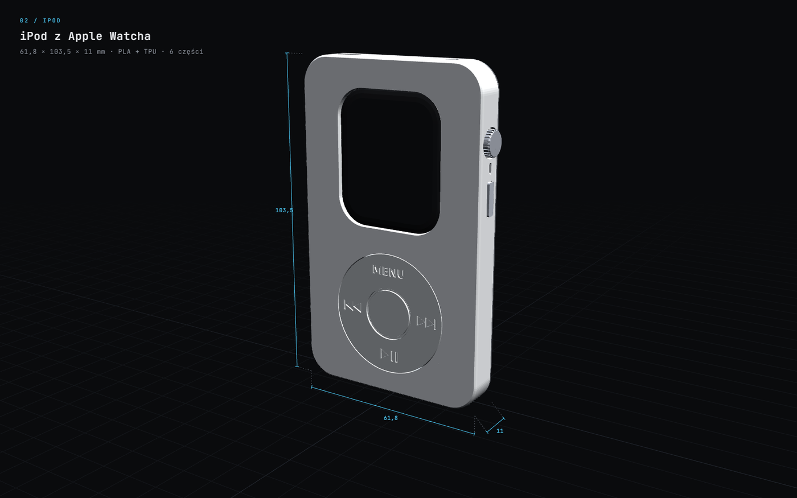
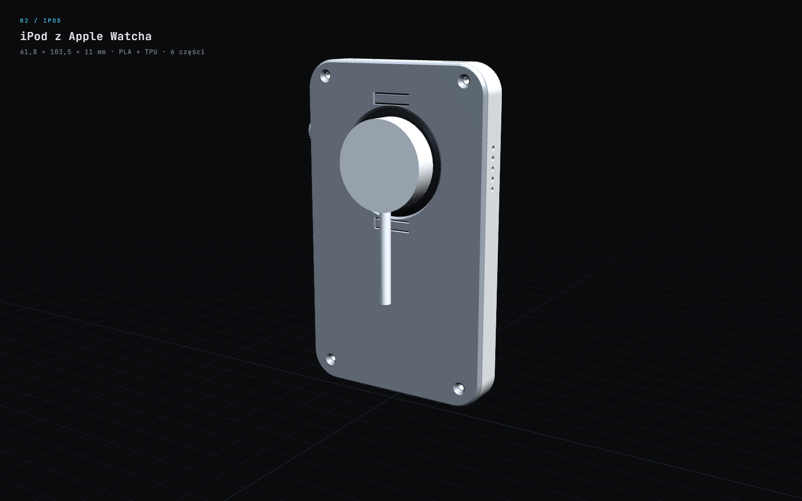
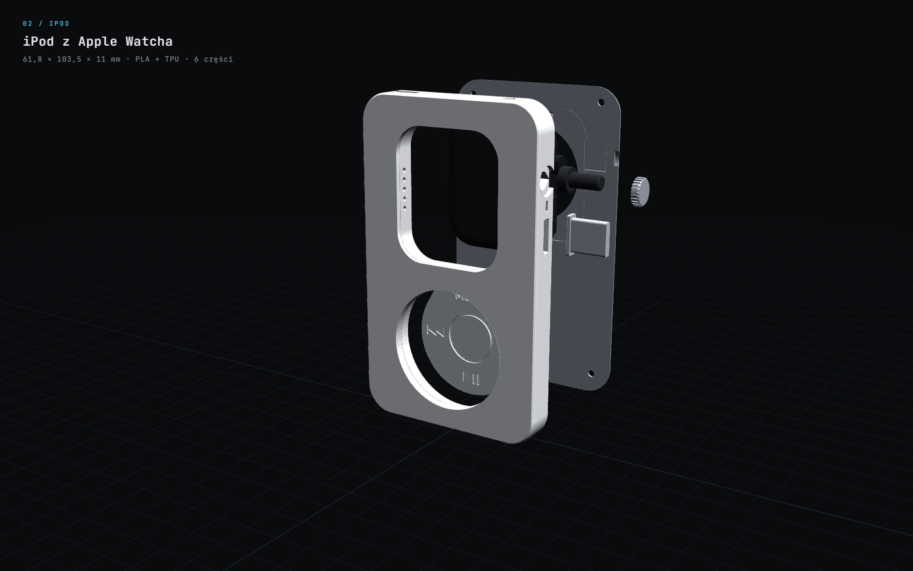
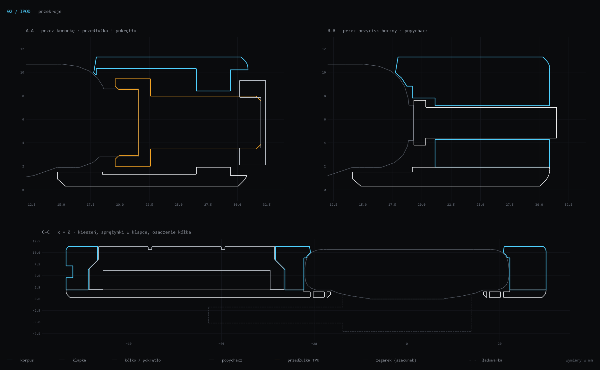

<div align="center">

<a href="https://pi0trdotsys.github.io/apple-watch-3d-prints/#model=ipod"></a>

`02 / ipod`

# iPod z Apple Watcha

Obudowa w proporcjach iPoda classic: 61,8 × 103,5 × 11 mm.<br>
Zegarek jest ekranem, koronką kręcisz pokrętłem z boku, a ładowarka przyczepia się przez okno w klapce.

[**▶ podgląd 3D**](https://pi0trdotsys.github.io/apple-watch-3d-prints/#model=ipod) &nbsp;·&nbsp; [stl](stl/) &nbsp;·&nbsp; [generator](generuj_ipod.py) &nbsp;·&nbsp; [← AW44](../)

</div>

<br>

## części

| plik | materiał | rola |
|---|---|---|
| [`ipod_test_rog.stl`](stl/ipod_test_rog.stl) | dowolny | **drukuj najpierw** (ok. 30 min): sprawdza koronkę i przycisk |
| [`ipod_korpus.stl`](stl/ipod_korpus.stl) | PLA / PETG, biały | przód z oknem ekranu i kieszenią na zegarek |
| [`ipod_klapka.stl`](stl/ipod_klapka.stl) | PLA silk silver | tył z oknem Ø 33 na ładowarkę i dwiema sprężynkami |
| [`ipod_kolko.stl`](stl/ipod_kolko.stl) | PLA jasnoszary | kółko z napisem MENU i ikonami; obraca się luźno |
| [`ipod_popychacz.stl`](stl/ipod_popychacz.stl) | PLA / PETG | przycisk boczny |
| [`ipod_pokretlo.stl`](stl/ipod_pokretlo.stl) | PLA / PETG | pokrętło koronki |
| [`ipod_przedluzka_X.X.stl`](stl/) | TPU 95A | gniazdo na koronkę: 5 rozmiarów, 5,0–6,6 mm |

Do kupienia: **4 × wkręt M2×6** z łbem stożkowym (samogwintujący do plastiku albo zwykły M2).

| tył: ładowanie bez wyjmowania | części w kolejności montażu |
|---|---|
|  |  |

## jak działa

- **ekran:** okno 34,8 × 40,8 mm pokazuje cały aktywny obszar ekranu; rant jest 0,6 mm ponad szkłem,
- **trzymanie:** zegarek wchodzi od tyłu, a dwie sprężynki w klapce dociskają go do przedniego rantu i wyrównują niedokładność wymiarów,
- **koronka:** gniazdo z TPU nasuwa się na koronkę, a jego wałek wychodzi przez bok do pokrętła; obrót i wciśnięcie działają jak na zegarku,
- **przycisk boczny:** popychacz w szczelinie prawej ścianki,
- **dźwięk:** szczelina na mikrofon i pięć otworów na głośnik,
- **ozdoby:** suwak „hold”, gniazdo słuchawek i złącze dock to atrapy; wyłącza je `DEKOR = False`.



## test, zanim wydrukujesz całość

1. Wsuń `ipod_test_rog.stl` od tyłu na prawy górny róg zegarka, aż szkło oprze się o rant.
2. Sprawdź, czy otwór Ø 5,4 mm w boku jest na osi koronki, a szczelina popychacza na wysokości przycisku.
3. Wydrukuj 5 przedłużek z TPU i nasuń gniazda na koronkę. Zostaw to, które trzyma ciasno, ale da się je nasunąć palcami.

Jeśli coś się nie zgadza, popraw `KORONKA`, `PRZYCISK` albo `LUZ` w [`generuj_ipod.py`](generuj_ipod.py) i uruchom go ponownie.

## druk

| część | ustawienia |
|---|---|
| korpus | frontem do stołu, bez podpór; 0,2 mm, 3–4 obrysy, 15–20 % wypełnienia |
| klapka | zewnętrzną stroną do stołu; krawędzie mają fazkę 45°, więc nie ma nawisów |
| kółko | frontem do stołu, napisy wychodzą na gładkiej stronie |
| przedłużka | TPU 95A, gniazdem w dół |

## montaż

1. Od tyłu włóż kółko, kołnierzem do środka.
2. Od tyłu włóż popychacz: kołnierz zostaje w środku, pręcik wychodzi szczeliną.
3. Od tyłu włóż przedłużkę: wałek przełóż przez otwór w prawym boku i wysuń ją do oporu.
4. Włóż zegarek ekranem do przodu, koronką w prawo.
5. Wciśnij wałek, aż gniazdo nasunie się na koronkę, i nałóż pokrętło.
6. Załóż klapkę i przykręć 4 wkręty.

## kontrola

Wyniki są w [`raport.json`](raport.json).

| test | wynik |
|---|---|
| wszystkie części szczelne, po jednej bryle | ✓ |
| kolizje korpus / klapka / kółko / popychacz / przedłużka / pokrętło | 0 mm³ |
| kolizja korpusu i klapki z ładowarką | 0 mm³ |
| odstęp krążka ładowarki od klapki | 2,05 mm |
| docisk sprężynek do zegarka | zamierzony (0,5 mm ugięcia) |
| wcisk gniazda TPU na koronkę 5,8 mm | zamierzony (0,15 mm) |

## żeby działał jak iPod

- **muzyka offline:** w aplikacji Watch na iPhonie (Muzyka) dodaj playlisty i albumy; pobiorą się podczas ładowania,
- **słuchawki:** sparuj słuchawki Bluetooth bezpośrednio z zegarkiem,
- **blokada:** wyłącz „Wykrywanie nadgarstka” (Ustawienia → Kod), inaczej zegarek blokuje się po zdjęciu z ręki.

```bash
python generuj_ipod.py
```
